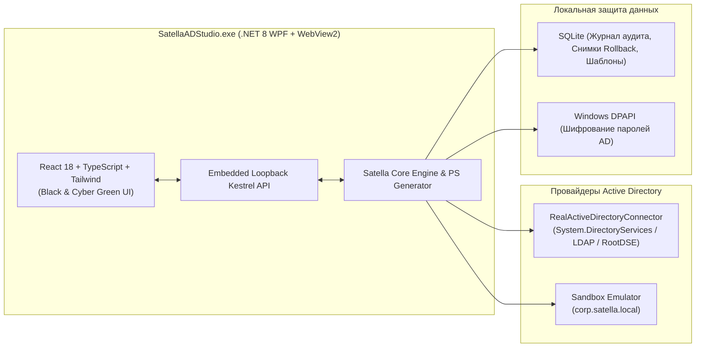

<div align="center">


# 🐵 Satella AD Studio 2.0

### Современная кибер-консоль управления Active Directory, GPO, LAPS и хостами Windows
**Сделано командой Crazy Monkeys**

[](https://dotnet.microsoft.com/)
[](https://react.dev/)
[](https://learn.microsoft.com/en-us/windows-server/identity/ad-ds/)
[](#)

</div>

---

## ⚡ О проекте

Классические оснастки Windows (`dsa.msc`, `gpmc.msc`, `dnsmgmt.msc`, `dhcpmgmt.msc`) не менялись более 20 лет: в них нет глобального поиска, отката ошибочных изменений, ролевых шаблонов онбординга, сравнения групп двух сотрудников и быстрого подключения по Shadow RDP.

**Satella AD Studio** — это единое нативное десктопное приложение под Windows в фирменном чёрно-зелёном кибер-стиле от команды **Crazy Monkeys**, объединяющее управление каталогом Active Directory, групповыми политиками, локальными паролями администраторов (LAPS), DNS/DHCP и удалёнными рабочими станциями.

---

## 🔥 Ключевые возможности

### 1. 🪟 Многооконные карточки пользователей (как в `dsa.msc`, но на стероидах)
- **Независимые плавающие окна**: открывайте сразу 2, 3 или 5 карточек разных пользователей на одном экране, перетаскивайте их мышью за заголовок и сворачивайте в нижнюю панель задач (Taskbar).
- **Умное управление группами (`Member Of`)**:
  - Мгновенный поиск по названию и описанию группы безопасности.
  - Чекбокс **«☑ Показывать только активные группы»**.
  - Выпадающий список **«+ Скопировать группы у коллеги...»** для переноса прав доступа в 1 клик.
- **Вкладка «Сравнить доступы»**: наглядное сравнение членства в группах между двумя сотрудниками с кнопкой добавления недостающих групп.
- **Прямой редактор атрибутов (`LDAP Attribute Editor`)**: чтение и изменение системных и кастомных атрибутов схемы AD (`userAccountControl`, `employeeID`, `homeDirectory`, `badPwdCount`, `objectSid`).

### 2. 🌳 Интерактивное дерево подразделений (OU) с Drag-and-Drop
- Перетаскивайте пользователей и компьютеры мышью прямо на любую папку `OU` в дереве для мгновенного перемещения (`Move-ADObject`).
- Массовые операции (`Bulk Actions`): выделение десятков учётных записей для одновременной разблокировки, включения/отключения или добавления в группу.
- Экспорт выборок пользователей в `CSV` в 1 клик.

### 3. 🚀 Конструктор ролевых шаблонов и Онбординг / Оффбординг в 1 клик
- **Создание и редактирование собственных шаблонов ролей**: задавайте целевую `OU`, должность, отдел и набор групп безопасности по умолчанию.
- **Авто-транслитерация ФИО**: вводите имя и фамилию на русском языке (`Максим Романов`) — Satella автоматически формирует логин `m.romanov` и почту `m.romanov@satella.io`.
- **Оффбординг (Увольнение в 1 клик)**: отключение аккаунта, удаление из всех групп (с сохранением снимка групп для отката!), скрытие из адресных книг и перенос в `OU=Disabled Users`.

### 4. 🖥️ Управление хостами, Shadow RDP, WinRM и консоль Windows LAPS
- **Shadow RDP в 1 клик**: просмотр активных пользовательских сессий на ПК и терминальных серверах с запуском `mstsc.exe /shadow:<id> /v:<host>` в режиме **Просмотра** или **Управления** без выбивания пользователя.
- **Консоль Windows LAPS / Legacy LAPS**:
  - Чтение атрибутов `msLAPS-Password` и `ms-Mcs-AdmPwd`.
  - Просмотр и копирование пароля `.\Administrator`, контроль даты истечения.
  - Кнопка **«Принудительно ротировать пароль LAPS»** (`Reset-LapsPassword` + сброс `msLAPS-PasswordExpirationTime = 0`) и единая матрица паролей LAPS по всем ПК домена.
- **Удалённый диспетчер задач и служб (WinRM)**: завершение зависших процессов (`1cv8c.exe`, `chrome.exe`), перезапуск служб Windows, чтение ошибок `Event Log` и массовое выполнение PowerShell-скриптов на выбранных хостах.

### 5. 🛡️ Конструктор групповых политик (GPO), делегирование ACL и DNS / DHCP
- **Создание и редактирование GPO**: управление статусом политики, привязками к подразделениям (`GPLinks`: `Enabled` / `Enforced`), фильтрами безопасности и правилами из готовой библиотеки безопасности AD + удалённый `gpupdate /force`.
- **Инспектор ACL**: просмотр и делегирование прав (`ResetPassword`, `WriteProperty`, `Read LAPS`, `FullControl`) на подразделения.
- **DNS & DHCP**: создание и удаление записей `A`, `CNAME`, `SRV`, `TXT` и закрепление динамических аренд DHCP в статические MAC-резервации в 1 клик.

### 6. ⏪ Машина времени (Rollback), Корзина AD и Генератор PowerShell (`</>`)
- **Откат действий администратора (`Rollback`)**: перед каждым изменением Satella сохраняет снимок объекта в локальной БД SQLite. Любое случайное изменение (даже увольнение с удалением всех групп) откатывается в 1 клик.
- **Корзина AD (`AD Recycle Bin`)**: восстановление удалённых объектов в исходное подразделение (`LastKnownParent`).
- **Инспектор PowerShell (`</>`)**: каждое действие в интерфейсе сопровождается готовым к запуску скриптом PowerShell (`ActiveDirectory` / `WinRM`), который можно скопировать или скачать как `.ps1`.

### 7. 🔌 Двойной режим: Реальный контроллер домена AD + Встроенная Песочница
- **Боевой режим LDAP / LDAPS**: авто-поиск текущего домена Windows (`RootDSE`), проверка соединения и двусторонняя синхронизация с реальным контроллером домена Windows Server / Samba AD. Пароли профилей шифруются через нативный **Windows DPAPI**.
- **Встроенный эмулятор (`corp.satella.local`)**: предзаполненный демо-домен для безопасного тестирования и обучения без риска для продакшена.

---

## 🏗️ Архитектура проекта



### Структура репозитория

```text
Satella/
├── assets/
│   └── pixel-monkey.svg               # Пиксельный логотип команды Crazy Monkeys
├── src/
│   ├── Satella.Core/                  # Доменные модели, интерфейсы и генератор PowerShell
│   ├── Satella.Infrastructure/        # LDAP/AD коннектор, эмулятор песочницы, SQLite и Windows DPAPI
│   ├── Satella.Desktop/               # Нативное окно WPF (.NET 8) + WebView2 + иконка monkey.ico
│   └── Satella.UI/                    # Фронтенд React 18 + TypeScript + Tailwind CSS
├── SatellaADStudio.exe                # Готовый автономный исполняемый файл под Windows x64
└── Satella.sln
```

---

## 🚀 Быстрый запуск

### Вариант 1: Готовое приложение (без установки зависимостей)
В корне репозитория уже собран автономный однофайловый релиз:
1. Запустите **`SatellaADStudio.exe`** двойным кликом.
2. Для подключения к своему домену нажмите **«+ Подключить AD»** $\rightarrow$ **«🔍 Авто-поиск домена Windows»** $\rightarrow$ **«⚡ Проверить подключение к DC»** $\rightarrow$ **«Сохранить и подключиться»**.

### Вариант 2: Сборка из исходников
Требования: `.NET 8.0 SDK` и `Node.js 20+`.

```powershell
# 1. Сборка фронтенда
cd src/Satella.UI
npm install
npm run build
cd ../..

# 2. Сборка единого исполняемого файла SatellaADStudio.exe
dotnet publish src/Satella.Desktop/Satella.Desktop.csproj -c Release -r win-x64 --self-contained false -p:PublishSingleFile=true -p:IncludeNativeLibrariesForSelfExtract=true -o Release
```

---

<div align="center">
  <b>🐵 Сделано с душой командой Crazy Monkeys • 2026</b>
</div>
